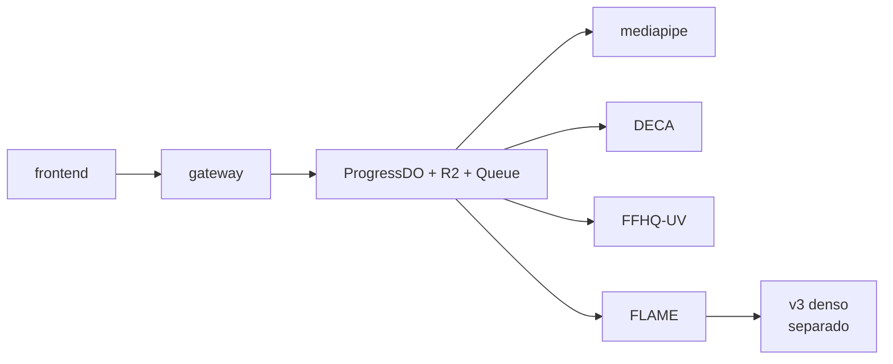

# ARCHITECTURE — Vultus

> **Fuente de verdad:** `edge/contract.ts` para el contrato HTTP · `backend/domain.py` para invariantes ML/compute · este doc solo explica forma, no flujo.
> `CONTRACT_VERSION = 3` · zip-8 forense sin heatmap · FLAME 5023 · TTL 60 · track v3 en paralelo sin tocar la vía forense.

   

## 0. Mapa en 30 segundos

| Pregunta | Respuesta (código) |
|---|---|
| ¿Quién es dueño del contrato HTTP? | `edge/contract.ts` — Python lo espeja, nunca al revés (`backend/domain.py:1-6`) |
| ¿Quién sirve HTTP? | `edge/worker.ts` (prod) · `edge/worker.dev.ts` envuelve prod + 2 rutas dev (`worker.dev.ts:9,57,75`) |
| ¿Dónde vive el estado del job? | `edge/progress-do.ts` (`ProgressDO`: `init`/`progress`/`status` + WS + alarmas) |
| ¿Quién corre ML? | `backend/modal_app.py` (`/ml/landmarks\|fit\|texture` + `queue_pull_consumer`) y sidecar local `:8081` |
| ¿Quién orquesta en local? | `backend/pipeline_local.py` (`run_pair`) + `backend/local_runner.py` (webhook `:8001`, `HttpProgressSink`) |
| ¿Qué sale del pipeline? | zip-8 en orden canónico (`domain.py:74-83` espejo `contract.ts:64-73`) |
| ¿Qué no se toca? | La vía forense está congelada; v3 vive en `backend/v3_*.py` + `GET /v3/jobs/{id}/figure` |

```mermaid
graph TD
    FE[frontend · Astro static<br/>islas UvViewers + ThreeViewer<br/>Pages prod]
    API[gateway · Worker TS<br/>valida + R2 + Queue + DO<br/>worker.ts prod / worker.dev.ts dev]
    DO[ProgressDO<br/>init progress status WS alarm<br/>TTL 60 + purga 2xTTL]
    R2Q[R2 + Queues<br/>pointer jobs/id/a|b<br/>result.zip 60s]
    RN[runner local :8001<br/>webhook + sink HTTP<br/>local_runner.py]
    MO[Modal GPU<br/>mediapipe fit texture<br/>v3_figure_worker + pull consumer]
    SC[sidecar :8081<br/>mismo modal_app<br/>paridad local]
    W1[MediaPipe 478]
    W2[fit DECA feed-forward<br/>253 coefs + cámara]
    W3[textura FFHQ-UV<br/>piel total + ojos aparte]
    W4[assemble FLAME CPU<br/>5023 + PBR + zip-8]
    V3[v3 denso 20481<br/>1024 + relights<br/>cola separada sin TTL60]

    FE --> API
    API --> DO
    API --> R2Q
    R2Q --> RN
    R2Q --> MO
    RN --> SC
    SC --> W1 & W2 & W3
    MO --> W1 & W2 & W3 & V3
    W1 & W2 & W3 --> W4
    W4 --> R2Q
    DO --> FE
```

## 1. Principios

- **Stateless por defecto.** Nada persiste más allá de la ventana: DO TTL 60 + purga a 2×TTL, R2 `jobs/` con borrado lógico (cron 1/min borra `result.zip` en `expired`/purga) + lifecycle red 1 día (`expire-jobs`, mínimo R2, ver `scripts/r2-lifecycle-apply.sh`), `/tmp` en tmpfs con `unlink` por job. v3 es la única excepción (retención lógica de días, cola separada; la red 1 día sobre `jobs/` aplica como piso hasta prefijo propio).
- **Parse-once en el borde, core sin revalidar.** `backend/domain.py:1-6` + `edge/contract.ts:254-308`. Todo lo que cruza un seam llega ya probado (`ImageBytes`, `JobId`, `Landmarks`, `GnmCoeffs`, `CameraParams`, `RenderedImage`, `TtlSecs`, `Stage`, `ContractVersion`). El core nunca lanza por input esperado: retorna `Result`.
- **Deep modules, interfaces estrechas.** Cada worker una sola responsabilidad. `workers/*` no conocen HTTP ni frontend. El sink `report/complete/fail` es el único acoplamiento pipeline→progreso.
- **Un solo dueño por seam.** TS es dueño del ciclo HTTP; Python es dueño del runner local, el orquestador y el assemble CPU. Sin duplicar `TtlSecs` ni ciclo de vida en Python.
- **Async por queue, no por threads en el gateway.** El Worker valida y encola `{job_id, r2_keys}`; el paralelismo A/B vive en `run_pair` (`ThreadPoolExecutor(2)`), no en el edge.

## 2. Seams (fronteras testables)

> Seam = frontera pública donde se testean comportamientos sin mirar internos.

### Seam 1 — HTTP API · `edge/worker.ts:433-516`

| Ruta | Método | Respuesta canónica |
|---|---|---|
| `/health` | `GET` | `{status:"ok", gateway:"worker", queue:"ok", ttl_secs, contract_version:3}` (+ `ttl_error` si inválido) |
| `/v1/compare` | `POST multipart` | `202 {job_id, status:"queued"}` · `400` validación · `500` bindings |
| `/v1/jobs/{id}` | `GET` | `200 {job_id, status}` · `400` uuid roto · `404` desconocido (lee DO `/status`) |
| `/v1/jobs/{id}/result` | `GET` | zip-8 `StreamingResponse` · `404/409` reintentable · `404` tras purga |
| `/v1/jobs/{id}/progress` | `POST` | sink prod (workers GPU reportan aquí) |
| `/v1/jobs/{id}/events` | `WS` | snapshot + ticks 500 ms ×120 (60 s) hasta terminal |
| `/v3/jobs/{id}/figure` | `GET` | `figure-v3.zip` (track denso, retención días, nunca `result.zip`) |
| `OPTIONS *` | `OPTIONS` | `204` + CORS |

Entrada dev (`edge/worker.dev.ts`) agrega **exactamente dos rutas**, solo con `ALLOW_DEV_ROUTES=1`:

- `GET /dev/blobs/:job/:slot` (`slot = a|b`, `400` slot inválido)
- `PUT /dev/results/:job` (body `PK`, máx 32 MiB, `400` bundle inválido)

Con vars de prod responden `404`. El bundle de prod nunca referencia este módulo. El consumer dev reenvía cada mensaje a `RUNNER_WEBHOOK_URL` (`worker.dev.ts:93-112`); sin la var falla ruidoso.

### Seam 2 — Progress Sink · `backend/pipeline_local.py:82` + `backend/local_runner.py:205`

Contrato: `report(Progress, Stage)` · `complete(CompareResult)` · `fail()`.

- **Local/dev/test:** `HttpProgressSink` (runner → `POST /progress` + `PUT /dev/results`) e `InMemorySink` en tests.
- **Prod:** workers GPU al mismo seam HTTP + `R2 result.zip` directo.
- Testeable con sink en memoria sin tocar Cloudflare. No se testea Queues/R2 interno.

Hitos (`contract.ts:41-44` espejo `domain.py`): `0.40 fit` · `0.75 texture` · `0.95 assemble` · `1.0 done`.

### Seam 3 — Worker Contract · `backend/pipeline_local.py:122-179` + `backend/modal_app.py`

```
&ImageBytes + &Landmarks(478)
  -> FitResult (253 coefs + cámara 3×4 = 1060 bytes, wire v2 VERSION+u32BE+body)
  -> RenderedImage (UV_LEN 512×512×3 = 786432) + EyeTexture (UV_LEN, ojos aparte)
```

- `MlSidecarClient { landmarks, fit, texture }` + `BaseUrl` (`http(s)://`, recorta `/`).
- `VersionMismatch → 400` para wire v1 o versión desconocida; consumo exacto sin sobrantes. Truncado = `FitFailed 500`.
- Goldens: cero `SKIN_SENTINEL (255,0,255)` en máscara skin, `evidence ≥ 0.99`, bytes idénticos ×2, `GLB magic glTF` FLAME 5023 con `SkinPBR/EyePBR` sin emisivo, eye slice 1092.

**No son seams:** `flame_distance`, `displaced_positions`, partición piel/ojo y PBR internos. Se cubren vía Seam 3.

## 3. Módulos

### 3.1 gateway — shallow TS

`edge/worker.ts` (prod, fino: valida + R2 + queue + DO) · `edge/worker.dev.ts` (dev: envuelve prod + 2 rutas + consumer) · `edge/contract.ts` (fuente única: brands, `Result`, hitos, `ZIP_MANIFEST`, `V3_*`) · `edge/progress-do.ts` (DO) · `edge/assert.ts` (`assertNever`).

Valida `multipart`, magic JPEG (`FF D8 FF`) / PNG (`89 50 4E 47 0D 0A 1A 0A`) y tamaño (`MAX_IMAGE_BYTES = 8 MiB`). Encola solo `{job_id, r2_keys}` (patrón **R2 pointer**: Queues < 128 KiB, no caben 2×8 MiB). Errores → `400|404|500` con `{"detail":…}`. Cero lógica de visión.

### 3.2 progreso y cómputo — deep edge

`ProgressDO` (`progress-do.ts:31`): ciclo `queued → processing → done|failed|expired`, `TTL 60`, ventana `expired` visible, purga a 2×TTL vía `alarm()` en 2 fases. El cron 1/min (`worker.ts:sweepExpiredResults`, `[triggers]`) borra `result.zip` en `expired`/purga; nunca `figure-v3.zip`. `load()` revalida storage corrupto a 60 con log throttled por instancia. `TtlSecs 1..=3600` vía `parseTtlSecs → Result InvalidTtlSecs`; shell `resolveTtlSecs` defaultea a 60 con log, DO responde `400`.

### 3.3 workers ML + assemble

| Worker | Código | Input → Output | Notas |
|---|---|---|---|
| 1 MediaPipe | `modal_app.py:_impl_landmarks/mediapipe_infer` | `&ImageBytes → Landmarks(478 JSON)` | CPU 20-30 ms; stub `{"todo"…}` = `Ml::Decode` |
| 2 fit DECA | `flame_fit.py:fit_flame` + `deep3d.py:ReconNet` | `image+landmarks → FitResult` | feed-forward determinista, deadline 10 s; sin pesos → doble geométrico 68 (vía en stats `deep3d`), con `VULTUS_REAL_ML=1` falla loud |
| 3 textura | `flame_texture.py:bake_flame` + `texgan.py` + `dpr.py` | `image+fit+landmarks → RenderedImage + ojos` | unwrap 512 + completion TexGAN enmascarada + DPR SH9; `concurrency_limit=1`; cuello de botella |
| 4 assemble CPU | `gnm_assemble.py:build_personalized_glb` + `gnm.py:build_result_zip` | `fit+albedo → GLB + zip-8` | FLAME `VERT_COUNT=5023`, ojos `[3931:5023)` 1092 verts, `FLAME_TRI_COUNT=9976`, 2 primitivas PBR sin emisivo, `NORMAL` suave, cuello abierto |

Malla densa HiFi3D++ evaluada y **rechazada este ciclo** (ADR-009): `deep3d.py:reconstruct_dense` solo como herramienta de decisión; el contrato sirve FLAME 5023. Cuello abierto por diseño (ADR-010): `NECK_BOUNDARY_MODE="open"`, sin hombros, costura disimulada con textura.

Puente de pesos (8 archivos + legados): `mediapipe/face_landmarker.task`, `deca/deca_model.tar`, `flame/flame2023_Open.pkl`, `ffhq-uv/FLAME_w_HIFI3D_UV.obj + eye_ball_tex.png`, `checkpoints/texgan_model/texgan_ffhq_uv.pth`, `checkpoints/deep3d_model/epoch_latest.pth`, `topo_assets/unwrap_1024_info.mat + hifi3dpp_mean_face.obj`, más `flame_template.bin + flame_hifi_transfer.npz + flame68_embed.npz`. Envs `TEXGAN_DIR/DEEP3D_DIR/TOPO_DIR/DPR_DIR` con defaults bajo `WEIGHTS_ROOT`. Ver `PIPELINE.md §7` y `DEVELOPMENT.md §8`.

### 3.4 models (adaptadores)

Únicos lugares con `torch/mediapipe`: `modal_app.py` + `flame_*` (lazy). `diffusers` pineado pero sin imports: candidato a retirar junto a los pesos GNM tras el cutover. `gnm_head.py` / `gnm_texture.py` legacy sin caller productivo (bake gris falla ruidoso).

### 3.5 frontend — Astro static

`frontend/src/pages/index.astro` (form + script ~425 líneas) · `compare-client.ts` (parse-once, `API_PATHS`, `RESULT_FILES` zip-8, `CONTRACT_VERSION=3`, `tryExtractViewerBlobs` vía JSZip) · `UvViewers.astro` (progreso + UV A/B + download) · `ThreeViewer.astro` + `three-rig.ts` (estudio blanco, 2 canvas `viewer-3d-a/b`, conserva materiales GLB, sondas cromo+grafito, `RoomEnvironment`). Ver `DESIGN.md`.

`/health` expone `contract_version`; el frontend valida y muestra `actualiza` ante mismatch — cero panel roto.

### 3.6 track v3 — paralelo, sin tocar forense

`backend/v3_contract.py` + `v3_dense.py` + `v3_texture.py` + `v3_pose.py` + `v3_light.py` + `v3_bundle.py` + `v3_worker.py` y `edge/contract.ts:V3_*`. Denso `20481v/40832f`, atlas 1024 (`V3_UV_LEN = 3145728`), `TV ≤ 2.0`, bundle de 6 (`mesh_dense.glb`, `albedo_1024.png`, `relight_{neutral,key,fill,rim}.png`), retención lógica 7 días (`V3_RETENTION_DAYS`, cola separada `v3-queue`, timeouts 600/900), gate FFHQ 1024 + yaw 15°. Excepción aparte: `figure-v3.zip` vive hoy bajo `jobs/` (`worker.ts:373`), así que la red `expire-jobs` 1 día aplica como piso mínimo; los 7 días exigen prefijo propio futuro con regla aparte. Ver ADR-011.

## 4. Dependencias (siempre hacia adentro)



Ningún `models` importa `api` o `core`. Workers se testean sin levantar gateway.

## 5. Decisiones (ADRs)

### ADR-001 ARQ sobre Celery — histórico, superado por ADR-005

ARQ era asyncio nativo sin `billiard`/`kombu`. Al mover la API fuera de Python dejó de aplicar. Se conserva por contexto.

### ADR-002 Fit GNM directo — revocado por ADR-008

Fit directo con `Compare = distancia de coefs + albedo; el heatmap sobrevive`. El heatmap **ya no sobrevive**: ver ADR-008.

### ADR-003 Stateless sin Postgres ni S3

Sin cache ni re-descarga desde servidor; se gana privacidad y simplicidad. Local: DO TTL 60 + purga 2×TTL + tmpfs. Prod: borrado lógico 60s (DO + Python DEL) + lifecycle red 1 día (`expire-jobs` sobre `jobs/`, mínimo R2) + Queues retención 24 h pero TTL lógico 60 vía alarm.

### ADR-004 Cloudflare + Modal

Edge `Pages + Workers + Queues + R2 + DO + Turnstile/WAF`, GPU `Modal` vía `HTTP Pull Consumer`. Coste fijo `Workers Paid $5/mes + Modal $30/mes free` (~9.300 compares), luego `$0.0032/compare` T4. Descartados: `Vercel+Fly+Upstash` ($25-60 + egress), `HF Spaces` (sleep/cold), `100% Workers AI` (sin fidelidad FreeUV), `GCP GPU` ($80-200).

### ADR-005 Híbrido TS + Python sidecar ML

Gateway TS fino; ML GPU Python tras `POST /ml/*`. Reescribir fitting a `ort/candle/burn` costaría meses y rompería fidelidad. Frontera: tipos probados por HTTP + wire versionado.

### ADR-006 Parse-don't-validate + goldens

Tipos probados en `parse`, errores taxonómicos con mapeo fijo (`VersionMismatch → 400 actualiza`), goldens literales a mano, relojes manuales sin sleeps. `Queue` recibe comandos, no bytes sueltos; `set_progress` exige `Stage`, no `&str`.

### ADR-007 Edge GET lee Durable Object

`GET /v1/jobs/{id}` lee `ProgressDO /status`. Dummy `queued` solo como fallback sin binding en `wrangler dev`. DO sin `init` → `404`; tras purga → `404`.

### ADR-008 Corte heatmap y gris honesto (revoca ADR-002)

Se abandona gris + heatmap en el mismo corte (Wave 1). Seam 3 pasa a `FitResult → RenderedImage(piel total) + EyeTexture`. Zip canónico sin `heatmap.png`. **Disclosure pericial:** la completion es visual, distinta de evidencia; el perito debe saber que el corte fue intencional. Borrado seguro posterior: puente nuevo → cutover → y solo entonces borrado de pesos GNM, nunca antes.

### ADR-009 Quedarse en FLAME 5023

Densa HiFi3D++ (20481/40832) evaluada con el mismo fit (renders efímeros fuera del repo): más detalle pero rompe contrato, zip, visor, extractor, Volume y `BRIDGE_FILES` sin beneficio forense proporcional (el comparador vive de coefs + albedo). `reconstruct_dense` queda como herramienta de decisión. Sin globos oculares portados ni unwrap 1024 propio, GLB 4× más pesado en el mismo TTL 60.

### ADR-010 Cuello abierto + entrada frontal

Cuello abierto por diseño (`NECK_BOUNDARY_MODE="open"`, `VERT_COUNT` intacta, sin hombros). Foto 3/4 degrada por diseño (afín por bbox, facing cull frontal, PnP descartado). No se promete render limpio de lados ocultos.

### ADR-011 Track v3 FFHQ-UV figure en paralelo (revoca solo para v3)

Congela la vía forense (zip-8, 5023, TTL 60, `CONTRACT_VERSION=3` en path `/v1`) y crea v3 en paralelo (`V3_*` disjuntos, atlas 1024, retención días, worker GPU de minutos, cola separada). Si v3 quiere cutover, se promueve con migración por seams y versión mayor — nunca mezclando refactors. Ramas por job (`deep3d=/pose=/texgan=/dpr=/displacement=`), prohibido fallback sin log.

### ADR-012 Zip-8 con renders frontales (extiende ADR-008)

El zip pasa de 6 a **8 piezas** añadiendo `render_a/b.png` (frontales 512) al final del orden canónico. `CONTRACT_VERSION = 3`. El transporte no cambia, el payload sí; mismatch = `VersionMismatch actualiza`, sin dual-read. `V3_CONTRACT_VERSION_NUMBER = 3` vive en path `/v3` separado: mismo número, sin colisión en wire.

## 6. Data Flow

Imagen entra como `bytes` y nunca toca disco persistente más allá de `tmpfs`/R2-60s.

- **Prod:** `Browser → Worker POST /v1/compare → R2 PutObject → Queues {job_id, r2_keys} → Modal pull → /tmp tmpfs → R2 result.zip → Worker StreamingResponse → olvido (lifecycle + unlink)`.
- **Local:** `Browser → worker.dev → R2/Queue/DO emulados → consumer dev → webhook runner :8001 → blobs por /dev/blobs → sidecar :8081 → PUT /dev/results → GET/WS`.
- Ningún artefacto en Postgres/S3 persistente.

## 7. Escalado

Local: servicios independientes vía `docker compose` (`api/runner/ml-sidecar/frontend`). Prod: Workers a 0 automático, Modal `0 → 100` (`Starter 10`, `Team 50` concurrency, cold 1-2 s). `texture concurrency=1` por GPU (no OOM); MediaPipe hasta 4 en CPU. R2/Queues sin gestión. v3 en cola separada con timeouts de minutos.

## 8. Observabilidad

`duration_ms` por etapa + `vram_mb` + `queue_lag_ms`. Fit expone `deep3d=/pose=` (`_LAST_FIT_STATS`); textura `parsing=/texgan=/dpr=/pose_tex=`; assemble `template synthetic=` + `displacement=`. Prohibido fallback sin log. Logs con `job_id`, sin bytes. `GET /health` verifica queue ping + `torch.cuda.is_available` en Modal. Prod: `Cloudflare Analytics + Workers Logs` (3 días free) + `Modal logs` + `OpenTelemetry` opcional.

## 9. Testing

Seam 1: suite pool en runtime real + WS real + negativo backdoor dev. Seam 2: sink en memoria. Seam 3: golden `UV_LEN` + `GLB magic` + cero sentinel + eye slice. Goldens literales, nada de unit tests al pipeline interno. Gates: `python3 scripts/e2e-flame-real.py` (margen + SSIM con pesos reales) y `bash scripts/modal-weights-sync.sh --check` (puente + cutover + backup). Ver `CONTEXT.md` y `PIPELINE.md`.
