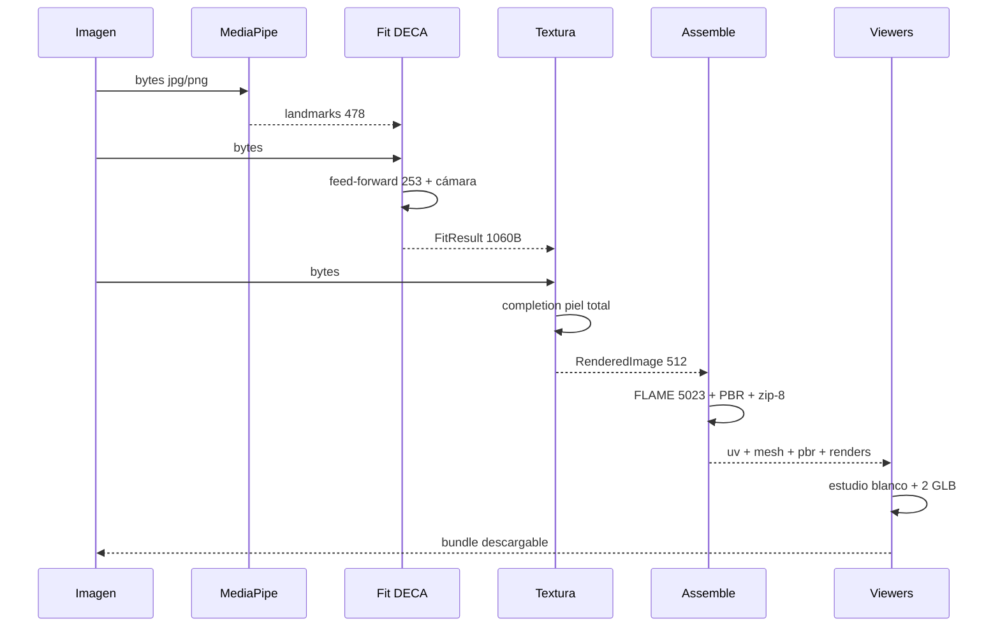
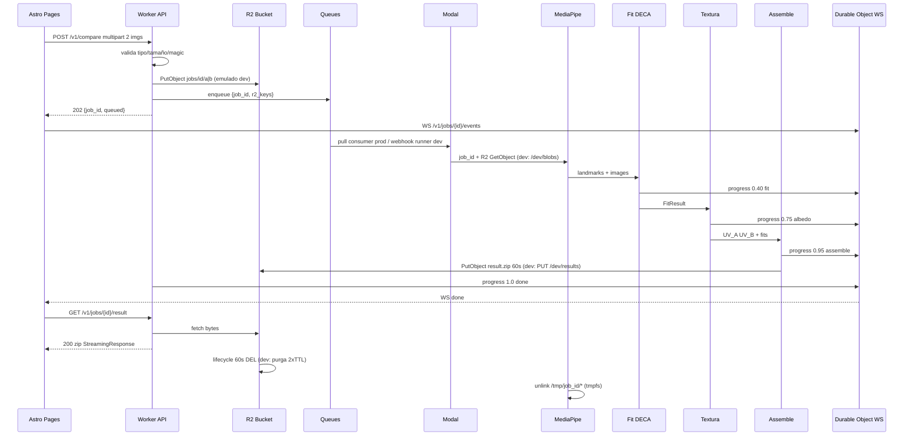

# PIPELINE — Flujo completo

> Fuente de verdad: `edge/worker.ts` (rutas) · `edge/progress-do.ts` (ciclo/TTL) · `backend/pipeline_local.py` (orquestador + wire v2) · `backend/local_runner.py` (webhook + sink) · `backend/modal_app.py` (workers GPU) · `backend/gnm_assemble.py + gnm.py` (zip-8).
> Presupuesto `5 + 10 + 30 ≤ 60 = TTL` · zip-8 v3 sin heatmap · stateless con olvido total.

  

## 1. Resumen

El usuario sube 2 caras → el gateway valida y encola `{job_id, r2_keys}` → MediaPipe → fit DECA → textura FFHQ-UV → assemble FLAME → zip-8 → descarga → olvido. Async, stateless, sin persistencia. En prod cada etapa GPU corre en Modal vía `HTTP Pull Consumer`; en dev el runner local consume la queue emulada vía webhook.

## 2. Diagrama end-to-end

> Prod: Pages + Workers + Queues + R2 + DO + Modal. Dev: mismo worker con R2/Queue/DO emulados (`wrangler.dev.toml`) + runner webhook, sin Redis.

```mermaid
graph TD
    A[Astro Pages<br/>upload 2 jpg/png] --> B[Worker POST /v1/compare<br/>prod y dev]
    B --> C{validación + R2 PutObject}
    C -->|400| E[Bad Request sin encolar]
    C -->|ok| D["enqueue {job_id, r2_keys}<br/>a Queues"]
    D --> F[dev: consumer → webhook runner :8001<br/>prod: HTTP Pull Consumer Modal]
    F --> G[W1 MediaPipe 478 landmarks]
    G --> H[W2 fit DECA 253 + cámara]
    H --> I[W3 textura FFHQ-UV piel total]
    I --> J[W4 assemble FLAME 5023 + PBR + zip-8]
    J --> K[result.zip TTL 60s<br/>R2 prod / PUT /dev/results local]
    K --> L[Worker StreamingResponse zip]
    L --> M[cliente: UV_A/B + mesh + PBR + renders<br/>visor estudio + re-descarga local]
    K -. lifecycle 60s .-> N[olvido: tmpfs wipe + R2 DEL + purga 2xTTL]
    D -. progress 0.40/0.75/0.95/1.0 .-> O[DO WS /v1/jobs/id/events]
    O --> A
```

## 3. Secuencia de modelos

```mermaid
graph LR
    I["Imagen"] --> M["MediaPipe<br/>CPU 25ms"]
    M -->|"478 landmarks"| F["Fit DECA<br/>feed-forward + cámara<br/>GPU deadline 10s"]
    F -->|"FitResult 1060B"| U["Textura FFHQ-UV<br/>completion piel total<br/>GPU bottleneck c=1"]
    U -->|"RenderedImage 512"| G["Assemble FLAME<br/>piel/ojos + PBR + GLB<br/>CPU 150ms"]
    G -->|"zip-8"| H["Viewers<br/>estudio blanco<br/>CPU 200ms"]
    H --> O["uv_a/b mesh_a/b.glb pbr_a/b render_a/b"]

    style M fill:#e3f2fd
    style F fill:#fff3e0
    style U fill:#fce4ec
    style G fill:#e8f5e9
    style H fill:#f3e5f5
```



| Modelo | Depende de | Produce | Regla |
|---|---|---|---|
| MediaPipe | nada (entrada) | `landmarks 478` | stub/largo wrong = `Ml::Decode`; escribe `/tmp/{job}/landmarks.json` |
| Fit DECA | `image + landmarks` | `FitResult {253 + cámara 3×4}` | determinista ×2; sin cara `FitFailed` ruidoso; gate LFW `d(A,A)=0<d(A,B)<d(A,C)` |
| Textura | `image + fit + landmarks` | `RenderedImage` piel total + ojos aparte | cero sentinel, `evidence ≥ 0.99`, idéntico ×2; 2 ramas en paralelo, una por cara |
| Assemble | `fit + albedo` por cara | mesh personalizado + zip-8 | ojos `[3931:5023)` propios, PBR sin emisivo |
| Viewers | zip-8 canónico | UV A/B + 2 GLB estudio | `UvViewers` + `ThreeViewer`; sin heatmap ni slider |



Paralelización: A y B corren en paralelo en `MediaPipe → fit → texture` (un chain por cara, `ThreadPoolExecutor(2)`); `assemble` y viewers hacen join cuando ambas ramas terminan.

## 4. Secuencia detallada



## 5. Etapas

### 5.1 Entrada — `POST /v1/compare`

`multipart/form-data` con `image_a + image_b` (JPEG/PNG ≤ 8 MiB). Faltante o multipart roto → `400 {"detail"…}` sin encolar. OK → `202 {job_id, status:"queued"}`. `GET /v1/jobs/{id}` valida uuid con `trim` (`400` roto, `404` desconocido) leyendo `ProgressDO /status`.

### 5.2 Queue — Queues + R2 (prod) / emulados (local)

`R2 PutObject image_a/b` + mensaje `compare_job(job_id, r2_keys jobs/{id}/a|b)` (Queues < 128 KiB: nunca bytes). `10k ops/día free` (3 ops/job → ~3.333 jobs/día), retención 24 h pero **TTL lógico 60** vía alarm + lifecycle. Local: misma entrada dev emula R2/Queue/DO; consumer reenvía al webhook. Progreso por WS con `Stage queued|fit|texture|assemble|done`. Sin Postgres ni MinIO; egress R2 free.

### 5.3 W1 — MediaPipe 478

`MlSidecarClient::landmarks(&JobId, &ImageBytes) → Landmarks` (`POST /ml/landmarks`, `X-Job-Id`, `BaseUrl::join`). CPU 20-30 ms/cara. Stub o largo wrong → `Ml::Decode`.

### 5.4 W2 — Fit DECA

`MlSidecarClient::fit → FitResult` con `encode_fit_request` v2 (`VERSION 0x02 + u32 BE len + landmarks_json + image`) sobre `POST /ml/fit`. Respuesta `253 f32 LE + 12 f32 LE`. Feed-forward determinista, deadline 10 s. Gate LFW CHECK 5 con landmarks reales.

### 5.5 W3 — Textura FFHQ-UV

`MlSidecarClient::texture → RenderedImage` sobre `POST /ml/texture` (wire v2: `VERSION + u32 BE len(fit_request) + fit_request + fit_result`, consumo exacto). Piel total foto-derivada; `BaseUrl` exige `http(s)://`; vacío `Ml::Empty`, no-2xx `Ml::BadStatus`, truncate `Ml::Decode`, versión ajena `VersionMismatch 400`. Etapa más costosa (`concurrency_limit=1`).

### 5.6 W4 — Assemble + zip-8

Input `fit + RenderedImage` ya probados (`UV_LEN`). Partición piel/ojos (`EYE 3931:5023`, tris a caballo = `Err`), `build_personalized_glb` (2 primitivas `SkinPBR/EyePBR`, padding a 4), `build_result_zip` (8 nombres en orden), distancias antropométricas normalizadas por interpupilar. CPU 300-500 ms. Todo en `/tmp/{job_id}/`.

### 5.7 Entrega — `GET /v1/jobs/{id}/result`

Tras `WS done`, el Worker hace `R2 GetObject(result.zip)` → `StreamingResponse application/zip + Content-Disposition: attachment`, sin escribir a disco. Frontend crea `URL.createObjectURL` (`result-{jobId}.zip`) y ofrece re-descarga local desde memoria. Tras el stream: prod `lifecycle 60 s`, local purga 2×TTL. `404/409` = aún no listo (reintento acotado 10×1 s); `404` tras purga = expirado.

### 5.8 Limpieza stateless

`unlink /tmp/{job}/*` siempre (éxito o fallo) + `cleanup_job_dir`. Local: DO TTL 60 + purga 2×TTL. Prod: R2 lifecycle + alarm DO. Logs con `job_id + duration_ms`, sin bytes. Verificación: tests exigen `tmpfs` vacío + DO expone `expired` visible antes de purgar.

## 6. Contratos de datos

| Dato | Forma canónica |
|---|---|
| enqueue | `{job_id, r2_keys jobs/{id}/a\|b}` (R2 pointer) |
| fit wire v2 | `VERSION u8 + u32 BE len + landmarks_json + image` → resp `1060 B` |
| texture wire v2 | `VERSION + u32 BE len(fit_request) + fit_request + fit_result` → resp `UV_LEN` |
| WS events | `{job_id, progress 0..1, stage queued\|fit\|texture\|assemble\|done}` |
| zip-8 | `uv_a/b.png, mesh_a/b.glb, pbr_a/b.png, render_a/b.png` en orden |
| errores | `400` validación · `404` desconocido · `500` infra, cuerpo `{"detail"…}` |

v1 en vuelo durante deploy = `VersionMismatch 400` por diseño (flag-day con drain TTL60/visibility180, sin dual-read). `/health` expone `contract_version: 3`; frontend bloquea con `actualiza` ante mismatch.

## 7. Pesos, bridge y gates

Volumen `vultus-weights` (`SYNC_VERSION=4`, layout `/weights/{flame,deca,ffhq-uv,gnm,mediapipe}`):

```
mediapipe/face_landmarker.task
deca/deca_model.tar                                  (DECA_DIR)
flame/flame2023_Open.pkl                             (FLAME_ASSETS_DIR)
ffhq-uv/FLAME_w_HIFI3D_UV.obj + eye_ball_tex.png     (FFHQ_UV_DIR)
checkpoints/texgan_model/texgan_ffhq_uv.pth          (TEXGAN_DIR)
checkpoints/deep3d_model/epoch_latest.pth            (DEEP3D_DIR)
topo_assets/unwrap_1024_info.mat + hifi3dpp_mean_face.obj (TOPO_DIR)
checkpoints/dpr_model/trained_model_03.t7            (DPR_DIR)
flame/flame_template.bin + flame_hifi_transfer.npz + flame68_embed.npz
gnm/ legacy (rm solo tras cutover + backup verificada)
```

Gates: `fit_weights_present()` + `tex_weights_present()` deciden `PIPELINE_REAL`; `texgan/deep3d/dpr/parsing` igual. Extractores resuelven `ENV_DIR → WEIGHTS_DIR → repo weights/…`. Orden estricto: `puente-up → cutover(FLAME_CUTOVER=1) → backup(gnm→gnm.bak-<tag> + manifiesto sha256) → rm por archivo`. `--check` es solo lectura.

| Gate | Comando | Qué exige |
|---|---|---|
| visual FLAME | `DECA_DIR=… FLAME_ASSETS_DIR=… FFHQ_UV_DIR=… TOPO_DIR=… VULTUS_REAL_ML=1 python3 scripts/e2e-flame-real.py` | CHECK 0-7: sha256, landmarks reales, geometría, cero sentinel, ojos, determinismo ×2, margen `d(A,A)=0<d(A,B)<d(A,C)`, PBR/zip-8, SSIM misma>distinta |
| bridge | `MODAL_VOLUME=… R2_BUCKET=… bash scripts/modal-weights-sync.sh --check` | puente + cutover + backup por contenido |
| figura v3 | `DATASET_DIR=… python3 scripts/e2e-v3-figure.py` (`TEXGAN_STEPS` default 2) | denso 20481 + TV ≤ 2.0 + cero sentinel 1024 |
| SLO | `bash scripts/smoke-slo.sh` (`SMOKE_SLO_RUNS=10`) | `p95 < 20 s` compare-to-done (1 warmup excluido) |

Pesos y JPEGs LFW nunca se commitean (fotos congeladas por sha256).

## 8. Observabilidad y escalado

Por job: `duration_ms` por etapa, `vram_mb`, `queue_lag_ms`. Ramas efectivas en logs (`deep3d=/pose=/texgan=/dpr=/displacement=`; prohibido fallback sin log). Health verifica queue ping + `torch.cuda.is_available`. Prod: `Analytics + Workers Logs` (3 días free) + `Modal logs` + `OpenTelemetry` opcional.

Local: servicios independientes (`docker compose`). Prod: Workers a 0, Modal `0→100` (`Starter 10`, `Team 50`, cold 1-2 s), `texture c=1`, R2/Queues sin gestión. v3 en cola separada con timeouts de minutos (`600/900`) y retención de días — nunca en el presupuesto 60 s. Cache opcional `hash(image)→UV` en R2 con TTL 60 desactivada por defecto (stateless estricto).
