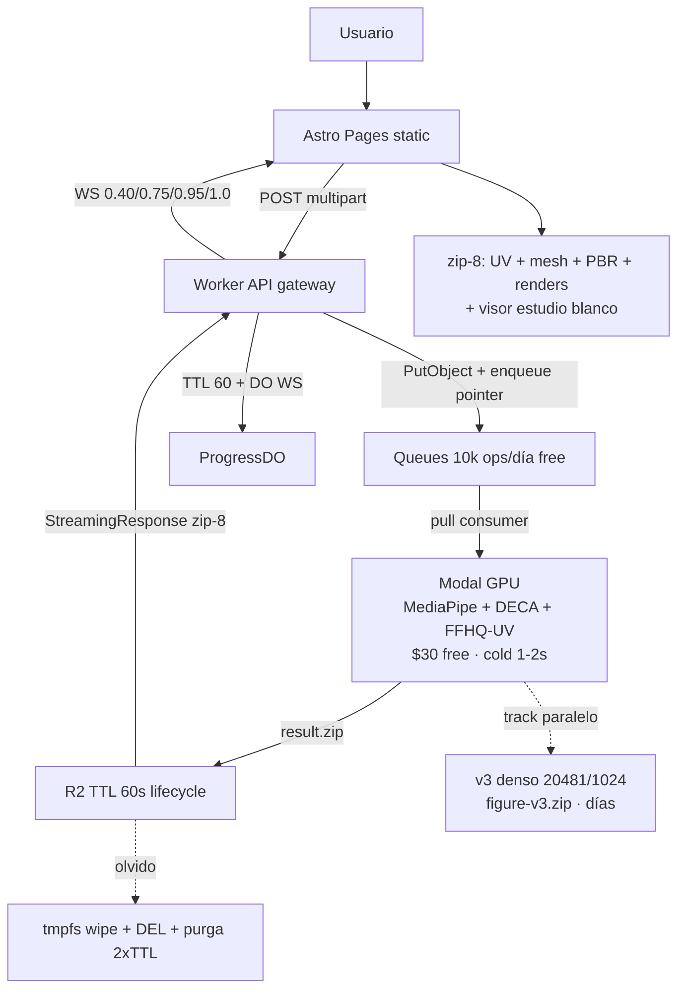

# ROADMAP — Comparador visual forense

> Fuente de verdad: código + `ARCHITECTURE.md` (ADRs) + `.github/workflows/cd.yml` (release).
> Estado: vía forense **v3 zip-8 viva** (FLAME 5023, TTL 60) + track v3 denso en paralelo. Sin Rust, sin API Python, sin Redis.

  

## 1. Resumen

Vultus compara 2 caras en espacio UV canónico: cada foto → `mesh 3D → unwrap → UV 512` → comparación pixel a pixel invariante a pose y expresión. Stateless por diseño: sin Postgres ni S3 persistente, sin re-descarga desde servidor (el cliente guarda el zip en memoria). Inferencia async vía Queues + workers.

## 2. Visión — por qué UV canónico

Overlay directo en espacio imagen falla con pose > 15° y distorsión de perspectiva. En UV canónico la textura es la fuente de verdad para métricas antropométricas, no la foto. La completion es visual y honesta (cero sentinel, `evidence ≥ 0.99`) con disclosure pericial: plausibilidad, no medición (ADR-008).

## 3. Arquitectura viva

> Infra: **Cloudflare + Modal** (ADR-004). Edge serverless + GPU serverless.



Stateless: worker solo `/tmp` tmpfs; resultado `jobs/{id}/result.zip` 60 s; mensaje Queues retención 24 h pero TTL lógico 60 vía alarm; dev `Store` emulado en memoria. Tras la descarga el cliente es dueño; el servidor no recuerda nada (GDPR friendly).

Flujo de un job: `POST /v1/compare → 202 + job_id` → `WS /events` → Modal `MediaPipe → FLAME → FFHQ-UV → assemble` → `R2 result.zip` → `GET /result` StreamingResponse → `lifecycle 60 s` + `unlink /tmp`. En dev idéntico pero con `R2/Queue/DO` emulados + webhook al runner `:8001` + sidecar `:8081`. Si se cierra la pestaña, expira y se reintenta.

## 4. Stack real

| Capa | Qué hay (código) |
|---|---|
| Gateway | TS Worker único (`edge/worker.ts` prod + `worker.dev.ts` dev + `contract.ts` fuente + `progress-do.ts`) |
| Compute local | Python (`domain.py`, `pipeline_local.py`, `local_runner.py`, `gnm_assemble.py`, `gnm.py`, `flame_fit/deep3d/dpr/texgan`) |
| GPU prod | `modal_app.py` (`/ml/*` + `fit/texture/mediapipe/v3_figure workers` + pull consumer) |
| Frontend | Astro 7 static + `compare-client.ts` + `UvViewers` + `ThreeViewer/three-rig` + `three 0.160.1` + `jszip` |
| Infra | `wrangler.toml` (prod) + `wrangler.dev.toml` (dev) + `docker-compose.yml` (4 servicios dev) + `modal` + `Pages` |
| Calidad | `mypy --strict` + `ruff py310` + `pytest` (32 módulos) + `vitest` unit + pool runtime + Playwright + smokes + gates reales |

Validación en bordes con `parse_* → Result`; queue con `R2 pointer` (`{job_id, r2_keys}`); CPU infallible (`UV_LEN`); ML vía `MlSidecarClient(BaseUrl)` + wire v2. Python nunca duplica el ciclo (vive en `edge/`).

## 5. Estructura

```
vultus/
├── ARCHITECTURE.md / CONTEXT.md / DESIGN.md / DEVELOPMENT.md / PIPELINE.md / ROADMAP.md
├── wrangler.toml / wrangler.dev.toml / docker-compose.yml / pyproject.toml
├── edge/            # contract + worker + worker.dev + progress-do + tests pool
├── backend/         # domain + pipeline_local + local_runner + gnm_assemble + gnm +
│                    # flame_fit/texture + deep3d/dpr/texgan + modal_app + v3_* + tests/
├── frontend/        # Astro Pages + compare-client + UvViewers + ThreeViewer/three-rig + e2e/
├── scripts/         # e2e-flame-real / e2e-v3-figure / modal-weights-sync + --check /
│                    # smoke-fase0/1/2/prod/slo + extract_* --check + render_diag
└── .github/workflows/ # ci.yml (fast + docker-cpu + docker-gpu) + cd.yml (tag → edge → modal → release)
```

## 6. Fases

### Fase 0 — Infra base ✅ HECHA

Gateway único TS + DO TTL 60 + R2/Queue emulados + runner webhook + sidecar + Pages. Done: `pytest` + pool suite + `docker compose up` + `wrangler dev` + job que se encola, se consume, retorna zip-8 y expira sin dejar `/tmp`.

### Fase 1 — MVP UV canónico ✅ HECHA

MediaPipe 478 + fit DECA feed-forward + textura FFHQ-UV con piel total + assemble FLAME + visores UV + 3D estudio blanco. Done: vuelta completa < 20 s en warm, `e2e-flame-real` CHECK 0-7 en verde con pesos reales, smoke prod `health gateway:"worker" + ttl 60 + 202 + status`.

### Fase 2 — Render 3D fotorrealista ✅ HECHA (zip-8)

GLB personalizado por cara (FLAME 5023, ojos propios, `SkinPBR/EyePBR` sin emisivo, `NORMAL` suave, cuello abierto) + PBR + **renders frontales 512** (`render_a/b.png`, ADR-012) + visor Three.js sincronizado con sondas cromo/grafito + `RoomEnvironment`. Done: `smoke-fase2` asserts `glTF, TEXCOORD_0, SkinPBR, EyePBR, pbrMetallicRoughness, sin emisivo, 5023 verts, PNG embebido, mesh_a ≠ mesh_b`.

### Fase 3 — Métricas forenses 🔶 PARCIAL

Hecho: subset 68 forense + distancias normalizadas por interpupilar en UV + determinismo ×2 + margen de identidad + SSIM. Falta: `report.pdf` con disclaimer + tabla (el zip-8 lleva UV/mesh/PBR/renders; el PDF sigue pendiente).

### Fase 4 — Hardening 🔶 PARCIAL

Hecho: rate limiting vía Turnstile/WAF (config), validación 8 MiB + magic, borrado verificado (`tmpfs` + lifecycle + purga), Playwright E2E, CI lint+typecheck, errores `Result` + `{"detail"…}`. Falta: activar Turnstile/WAF en prod + observabilidad completa (`Analytics + OpenTelemetry + Sentry`) + guardrails de borrado a 24 h si se usa TTL extendido.

### Fase 5 — Producción 🔶 PARCIAL

Hecho: CD `production → preview`, tag `v*.*.* → edge prod + Pages + Modal + Release`; frontend `vultus.esau.com.mx`, API `api.vultus.esau.com.mx`; smokes edge + E2E. Falta: dominio final `vultus.com/compare`, observabilidad, cutover de pesos GNM (puente → cutover → backup → rm, nunca antes). Coste: **$5/mes Workers Paid + $0 GPU hasta ~9.300 compares (Modal $30 free)**, luego `$0.0032/compare` T4.

### Track v3 — Figura densa 🔵 EN PARALELO (no bloquea forense)

`v3_dense/pose/texture/light/bundle/worker + contract` + `GET /v3/jobs/{id}/figure` + worker GPU de minutos en cola separada. Objetivo paper: malla densa texturizada neutral + 3 re-iluminaciones con esferas en 3 sujetos FFHQ, lado a lado, reproyección, TV 1024, margen de identidad, determinismo ×2. Regla: forense congelada (tests de freeze); v3 solo se promueve con migración por seams y versión mayor.

## 7. Deployment

**Elegida: Cloudflare + Modal (híbrida serverless).** Pages + Workers + Queues + R2 + DO + GPU por segundo. Fría 1-2 s vs 5-10 s Fly/RunPod; R2 egress free; stateless abarata todo (sin storage persistente).

| Opción | Coste | Veredicto |
|---|---|---|
| Cloudflare + Modal | $5 + $0 hasta 9k compares, luego $0.0032 | ✅ elegida |
| VPS soberano (Hetzner + Dokploy) | $40-90 fijo | alternativa GDPR estricta |
| GCP Cloud Run GPU | $80-200 | compliance EU, cara |
| Vercel + Fly + Upstash | $25-60 + egress | ❌ descartada |

CD (`.github/workflows/cd.yml`): push `production` → edge `--env preview` (staging sin GPU); tag `v*.*.*` en punta de `production` → edge prod + Pages + humo edge + `modal deploy` + humo final + `gh release`. `main` = integración (solo CI). Sin staging Modal (un environment `main`).

## 8. TDD — Seams y reglas vivas

- **Seam 1 HTTP:** `POST /v1/compare (202)` · `GET /v1/jobs/{id} (200/400/404)` · `GET …/result (zip-8/404/409)` · `POST …/progress` · `WS …/events` · `GET /v3/…/figure` · `GET /health (gateway:"worker", ttl 60, contract 3)`. Pool suite en runtime real + WS + backdoor dev `404`.
- **Seam 2 Sink:** `report(Progress, Stage) / complete / fail`. `MemorySink` vs `HttpProgressSink`; `Stage` enum, `Progress 0..1`, `TtlSecs 1..3600`.
- **Seam 3 Worker:** `&ImageBytes + &Landmarks(478) → FitResult(253+cámara, wire v2) → RenderedImage(UV_LEN) + EyeTexture`. Golden `UV_LEN=786432`, `GLB magic`, cero sentinel, eye 1092. No son seams: partición piel/ojo, `displaced_positions`, PBR internos.
- **Anti-patrones:** no mockear colaboradores internos; no recomputar esperado; no horizontal slicing antes de API; mock solo en boundaries (queue, tiempo, tmpfs, sidecar); DI para `MlSidecarClient` y sink; sin `Vec<u8>/&str` sueltos; sin `unwrap` en request path.
- **Slices:** `1 seam, 1 test RED, 1 implementación GREEN`. Ej. `test_frontal_face_produces_512_uv` con `parse(vec![…; UV_LEN])`; stateless verifica `tmpfs` vacío + `expired` visible; goldens literales (`Progress`, `JobId`, zip-8, sentinel, coefs).

## 9. Riesgos

| Riesgo | Estado / mitigación |
|---|---|
| Textura 12 GB VRAM, 8-15 s/cara | Modal serverless + `concurrency=1`; cache efímera opcional desactivada por defecto |
| GNM sin encoder imagen→params | resuelto: FLAME extrae, GNM no renderiza (assemble propio); densa rechazada ADR-009 |
| BFM ≠ GNM en topología | resuelto: transferencia IDW `flame_hifi_transfer.npz` + embed `flame68_embed.npz` |
| Sin storage no hay re-descarga | frontend guarda zip en memoria + re-descarga local |
| Pose 3/4 rompe afín frontal | por diseño (ADR-010): no se promete; v3 exige yaw ≤ 15° ruidoso |
| `modal serve` roba prod | prohibido; deploy solo en tag; schedule 5 s documentado |

## 10. Próximos pasos

1. Cierre Fase 3: `report.pdf` en el zip o como derivado (sin romper zip-8: nombre nuevo + versión mayor o endpoint aparte).
2. Cierre Fase 4: Turnstile/WAF on + `Analytics/OpenTelemetry/Sentry` + SLO `p95 < 20 s` en CI.
3. Cierre Fase 5: dominio final + cutover GNM (puente → cutover → backup → rm) + retirar `diffusers` y `gnm_*` legacy.
4. Track v3: figura densa en 3 sujetos FFHQ (criterio paper) sin tocar forense; cutover solo con migración por seams.
5. Deuda docs: ninguna tras este commit — los 6 docs espejan el código (`contract.ts`, `domain.py`, `compose`, `wrangler*`, `three-rig.ts`, `compare-client.ts`).
